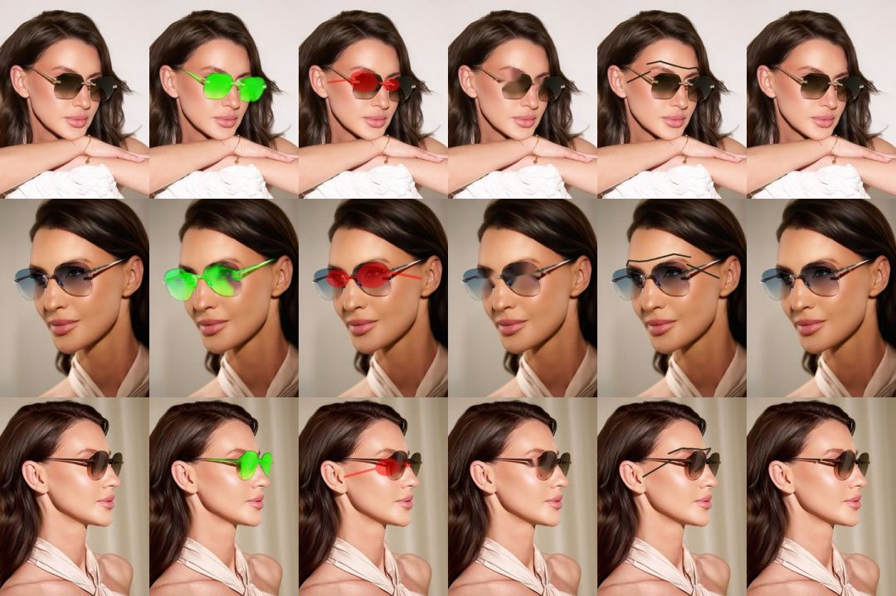

# Research: on-device frame removal for shoppers wearing glasses (issue #100)

Timeboxed spike, 2026-10-17. Question: can the try-on erase the shopper's own
glasses on-device, in real time, on mid-tier phones? Many shoppers can't see
without their glasses, so they try frames on over them. Fittingbox sells this
as "Frame Removal".

**Recommendation: go, with a narrow scope.** The scope is clear prescription
glasses only, behind an opt-in prop, as a ~2-week feature with a
mid-tier-and-up gate. **No-go** for sunglasses and tinted lenses: the eyes
behind them have to be invented, and the generative models that can do that
are 10–100× over the real-time budget in a browser. The segmentation half of
the problem is already solved by a model MediaPipe ships, and cheap classic
inpainting is good enough for thin rims and temples, which is all a
clear-lens frame leaves to remove. The rendered try-on frame then covers most
of the repaired area.



*Each row is a committed fixture (`tests/fixtures/faces/`). The columns are:*

1. *the original;*
2. *the MediaPipe multiclass segmenter's `others` class in green;*
3. *a landmark-only glasses mask in red;*
4. *classic Telea inpainting of that mask;*
5. *a synthetic 4 px "rim and temple" drawn over skin and hair;*
6. *that rim removed with Telea.*

*All three people wear tinted rimless sunglasses, the hardest case.*

## Findings

### 1. Segmentation: MediaPipe's multiclass selfie model already finds glasses

- `selfie_multiclass_256x256.tflite` (16 MB, float32, 256×256 input) labels
  every pixel as background, hair, body skin, face skin, clothes, or
  **others (accessories)**.
  [MediaPipe image segmenter](https://ai.google.dev/mediapipe/solutions/vision/image_segmenter)
- On our three fixtures, `others` covers the worn glasses closely: both
  lenses, the bridge, and the thin temple arms back to the hairline (column 2
  above). Share of the landmark-built lens regions labelled `others`:

  | Fixture | `others` | `face-skin` | `others` pixels outside the eye band |
  | --- | --- | --- | --- |
  | iris-moss (¾ view) | 85.5% | 14.5% | 5.0% (bracelet) |
  | pteron-azure (¾ view) | 73.7% | 26.3% | 0.3% |
  | kairos-amber (profile) | 52.7% | 47.3% | 0.0% |

  The misses are in the landmark lens region, not in the segmenter. That
  region is an ellipse sized from the eye corners. It doesn't follow real
  lens shapes, and in profile it lands partly on bare skin. Column 3 shows
  how badly a landmark-only mask fits real frames: its IoU with `others` is
  only 0.21–0.39. **Use the segmenter for the shape and landmarks only for a
  region of interest.** A box from tragus to tragus, eyebrows to nose tip,
  drops other accessories such as the bracelet in iris-moss.
- **Cost.** Google's Pixel 6 benchmark puts the whole pipeline at **71 ms on
  GPU** and 218 ms on CPU. The hair segmenter we already ship is 52 ms on
  GPU and 58 ms on CPU. In this spike's container (headless Chromium, Wasm
  CPU, no GPU) it took 330–470 ms a frame, about the same as the face
  landmarker there. So it can't run per frame. Like `useHairSegmenter`, it
  would run in its own worker at ~5–10 Hz, with the mask carried between
  updates by the tracked landmarks.
  Glasses don't move on the face, so a mask in face space stays valid until
  the next update.
- Licence: the MediaPipe Tasks code is Apache 2.0. Check the multiclass model
  card's terms for the weights before shipping. The alternatives are worse:
  face-parsing models with an eyeglass class (BiSeNet/SegFormer trained on
  CelebAMask-HQ) inherit that dataset's **non-commercial** licence.
  [CelebAMask-HQ](https://github.com/switchablenorms/CelebAMask-HQ),
  [SegFace](https://arxiv.org/abs/2412.08647)

### 2. Inpainting: classic is enough for rims and temples, never for lenses

- **Lenses.** Telea and Navier–Stokes inpainting of the whole glasses region
  (column 4) take 9–17 ms at 480×640 (native OpenCV, one core). They erase
  the eyes: behind tinted lenses there is nothing to propagate but skin. No
  non-learned method can bring eyes back. With **clear** lenses the eyes
  are visible, so the lens area must be **kept**, and only the frame around
  it removed.
- **Rims and temples.** I drew a 4 px frame-coloured bar over the brow (skin)
  and two over the temples (skin to hair), inpainted it with a 1 px margin,
  and scored the result against the untouched photo:

  | Fixture | Drawn (PSNR) | Telea | Navier–Stokes | Time |
  | --- | --- | --- | --- | --- |
  | iris-moss | 7.6 dB | 27.5 dB | 27.1 dB | 3.5–3.9 ms |
  | pteron-azure | 8.1 dB | 25.9 dB | 27.1 dB | 4.9–5.2 ms |
  | kairos-amber | 7.9 dB | 19.5 dB | 19.5 dB | 3.6–4.1 ms |

  On skin the bar is gone at a glance (column 6). Where it crosses the
  hair–ear boundary in profile (kairos-amber) a smudge is left, but that is
  exactly where the rendered temple arm sits. A Gaussian-blur fill of the
  same mask leaves a visible grey streak. In a browser, a WebGL
  pull-push/diffusion pass over the mask (a few ms on the GPU, no extra
  download) is the practical equivalent of Telea. OpenCV.js would add ~8 MB
  of Wasm for one function.
- **Learned inpainting** (for tinted lenses) is far over budget:
  - **MI-GAN**, the mobile-oriented state of the art (ICCV 2023), has
    ~5.9M parameters. It takes **~540 ms per 512² image on an iPhone 14 Pro
    Max**, 6–15× over a 33–90 ms frame budget.
    [MI-GAN](https://openaccess.thecvf.com/content/ICCV2023/html/Sargsyan_MI-GAN_A_Simple_Baseline_for_Image_Inpainting_on_Mobile_Devices_ICCV_2023_paper.html),
    [supplement](https://openaccess.thecvf.com/content/ICCV2023/supplemental/Sargsyan_MI-GAN_A_Simple_ICCV_2023_supplemental.pdf)
  - **LaMa's** ONNX export is 92.6 MB, per the LFS pointer in
    [opencv_zoo](https://github.com/opencv/opencv_zoo/tree/main/models/inpainting_lama).
  - Dedicated eyeglass-removal networks are GANs evaluated offline on single
    portraits, with no real-time or mobile figures:
    [ByeGlassesGAN (ECCV 2020)](https://arxiv.org/abs/2008.11042),
    [Lyu et al. (CVPR 2022)](https://arxiv.org/abs/2203.10474), which also
    removes cast shadows, and
    [unsupervised removal (2019)](https://arxiv.org/abs/1909.06989).

  None of them address temporal stability. Invented eyes that change from
  frame to frame would look worse than the glasses.
- Fittingbox's own description is a segmenter that sorts pixels into
  background, lens and frame, plus diminished-reality inpainting. It
  publishes no figures.
  [Fittingbox Frame Removal](https://fittingbox.com/en/glasses-virtual-try-on/advanced-website/frame-removal)
  That three-way split is the shape of the design below.

### 3. What clear lenses still leave behind

- **Refraction.** A −4 D lens shrinks the eyes noticeably and steps the face
  contour at the lens edge. Erasing the frame doesn't undo that. A
  correction would need the prescription, so it is out of scope. The new
  frame's lenses sit in about the same place and hide most of the step.
- **Reflections on the shopper's lenses** stay, since they are part of the
  kept lens area. The physical lens (#10) adds its own reflections on top, so
  they read as plausible.
- **Thick or acetate frames** leave a wide mask. Inpainting a 10–15 px band
  next to the eye is visibly softer than a thin rim. Where the new frame is
  thinner than the old one, that softness shows.

### 4. Privacy

Everything above runs on frames already inside the page. The segmenter would
run in a Web Worker like the hair segmenter, and inpainting would be a WebGL
pass on the render thread. No imagery leaves the device, and the module's
network use changes only by one more model download (16 MB, self-hostable).

## Design if we go ahead

1. **Gate.**
   - **Prop:** an opt-in `frameRemoval` prop.
   - **Tier:** a `frameRemoval` feature in `FEATURE_MIN_TIER` at `mid`, with
     a worker-time budget and self-disable like `useHairSegmenter`.
   - **Trigger:** it runs only when the segmenter reports `others` pixels in
     the eye band for a few consecutive updates, i.e. the shopper wears
     glasses. Otherwise it costs one segmentation at start.
2. **Segment.** In a worker at ~5 Hz, on a 256² crop around the eye band
   instead of the full frame, which gives more pixels per rim. The `others`
   mask is clipped to the eye band.
3. **Split lens and frame.**
   - **Lens interior:** the mask eroded by the rim width, measured as the
     band where `others` and strong edges coincide. It is **kept**.
   - **Rim and bridge:** the remainder inside the lens hulls.
   - **Temples:** the mask outside the hulls.
   - **Tinted lenses:** detected by the lens interior's luminance being much
     darker than the cheek. They switch frame removal off, and the UI is
     told (`frameRemoval.state = 'tinted'`) so the host can say "take your
     sunglasses off".
4. **Hold between updates.** The mask is stored in face space, as
   barycentric coordinates on the face mesh we already build for the
   occluder, and re-projected each frame, so it moves with the head at the
   tracking rate.
5. **Inpaint.** A WebGL pass on the video texture before compositing: a
   pull-push diffusion over the rim and temple mask, with a 1–2 px feathered
   edge. Everything else in the pipeline stays as it is, and the new frame
   renders on top.
6. **Test.** Add fixtures of three consenting people in clear prescription
   glasses (local-only like the UPNA clips if their licence requires it). On
   those fixtures, test:
   - goldens with frame removal on and off;
   - mask temporal stability (IoU between consecutive updates);
   - the step-down budget.

**Estimate: ~2 weeks.**
- 3 days: worker, ROI, mask in face space.
- 3 days: WebGL inpaint pass.
- 2 days: lens/rim split and tinted detection.
- 2 days: fixtures, goldens and the tier budget.
- Slack for tuning on real devices.

## Not established by this spike

- **Clear-lens quality was not measured.** All three committed fixtures wear
  tinted rimless sunglasses. This environment had no licensed footage of
  people in clear prescription glasses. The numbers above cover segmentation
  of real glasses, removal of synthetic thin rims, and the failure on tinted
  lenses. The first task of the feature is the clear-lens fixture set, and
  the go holds only if rim removal looks as clean on it.
- **Phone timings were not measured.** The segmenter cost is Google's Pixel 6
  figure plus this container's CPU-only figure. The inpainting cost is native
  OpenCV here. The WebGL pass needs a measurement on a mid-tier phone before
  the tier gate is set.

## Reproducing

```bash
# needs face_landmarker.task and selfie_multiclass_256x256.tflite in <models>
node docs/research/frame-removal/harness/segment.mjs <models> /tmp/seg.json
pip install numpy opencv-python-headless
python3 docs/research/frame-removal/harness/analyze.py /tmp/seg.json tests/fixtures/faces /tmp/out
```

`segment.mjs` runs FaceLandmarker and the multiclass segmenter (CPU delegate)
on the fixtures in headless Chromium. `analyze.py` writes `report.json` (the
tables above) and a contact sheet (the figure).
